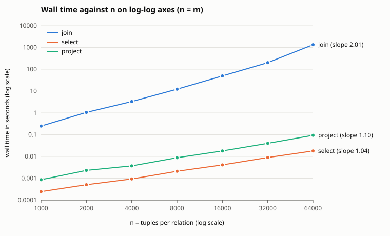

# REPORT.md

Performance study for the nested-loop relational algebra engine. Every number below is copied
from a CSV file in `results/` written by `source/benchmark.py`; the run log is
`results/benchmark_log.txt`.

## Machine and software

- Laptop with an Intel Core Ultra 7 265U (hybrid performance and efficiency cores, 14 logical
  processors visible to the operating system) and 32 GB of RAM.
- Windows 11 Pro, build 26200. The experiment ran inside WSL 2 on Ubuntu 26.04.1 LTS, Linux kernel
  6.18.33; the WSL virtual machine sees 15 GB of RAM.
- Python 3.14.4 (CPython), standard library only, single threaded.
- Method: `python3 -m source.benchmark all` wrote `results/join.csv`, `results/unary.csv` and
  `results/match_rate.csv`; the match-rate experiment was then repeated with
  `python3 -m source.benchmark matchrate` on an idle machine, and that repeat is the one reported
  in question 5. `python3 -m source.plot` drew `results/loglog.svg` and fitted the slopes. Only
  the call to `evaluate()` is timed, with `time.perf_counter()`; generating and loading the files
  is excluded. Each join size was run once. Select and project times are the best of five runs
  because they are sub-millisecond. Comparison counts are read from the counters inside `join`
  and `select` in `source/operators.py`, which are incremented once per pair or per tuple the
  condition is evaluated on; nothing is computed from n and m.

## Data

`source/generate_data.py` writes `R(a, b)` with the tuples `(i, i)` for `i = 0 .. n-1`, so `R.b`
is unique, and `S(b, c)` with m tuples. The match rate k is the average number of S tuples each
R tuple joins with: `round(k * n)` of S's tuples get a `b` that exists in R, spread evenly over
R's keys, and every other S tuple gets `b = n + j`, which matches nothing. The query is
`R join[R.b=S.b] S`. The join table used k = 0.1, so the output is 0.1 * n tuples.

## Required measurements: the join

| n | m | comparisons | wall time (s) | output tuples |
|---:|---:|---:|---:|---:|
| 1000 | 1000 | 1,000,000 | 0.2490 | 100 |
| 2000 | 2000 | 4,000,000 | 1.0484 | 200 |
| 4000 | 4000 | 16,000,000 | 3.3101 | 400 |
| 8000 | 8000 | 64,000,000 | 12.2316 | 800 |
| 16000 | 16000 | 256,000,000 | 49.4077 | 1600 |
| 32000 | 32000 | 1,024,000,000 | 201.6406 | 3200 |
| 64000 | 64000 | 4,096,000,000 | 1336.6872 | 6400 |

Source: `results/join.csv`. The 64000 run alone took 22 minutes.

## 1. The relationship between n, m and the comparison count

Comparisons = n x m, exactly, at every size. For 64000 x 64000 the product is 4,096,000,000 and
the counter read 4,096,000,000; the same holds for the other six rows.

There is no discrepancy because the join is a nested loop with no early exit: for every tuple of
R it evaluates the condition on every tuple of S, and the counter is incremented inside that
inner loop before the condition is evaluated, so matching and non-matching pairs are counted
alike (`join` in `source/operators.py`). The count depends only on the sizes of the two inputs.
The one way it could differ from the sizes of the files is duplicate tuples: a relation is a set,
so a file with repeated lines loads to fewer tuples than lines. The generator writes distinct
tuples, so n and m in the table are both the file sizes and the loaded sizes.

## 2. Time against n on log-log axes

The least-squares slope of log10(time) against log10(n) over the seven join points is **2.01**
(printed by `source/plot.py`). On log-log axes a slope of s means time is proportional to n^s.
A slope of 2 says that doubling both inputs quadruples the time, which is the signature of an
algorithm doing n x m work: with n = m, n squared. That is the nested loop.

The constant in front of n squared is the cost per comparison:

| n | seconds per comparison (microseconds) | time ratio to previous row | local slope |
|---:|---:|---:|---:|
| 1000 | 0.249 | | |
| 2000 | 0.262 | 4.21 | 2.07 |
| 4000 | 0.207 | 3.16 | 1.66 |
| 8000 | 0.191 | 3.70 | 1.89 |
| 16000 | 0.193 | 4.04 | 2.01 |
| 32000 | 0.197 | 4.08 | 2.03 |
| 64000 | 0.326 | 6.63 | 2.73 |

From 8000 to 32000 the cost per comparison is steady at 0.19 to 0.20 microseconds and the local
slope is 2.0. The three smallest sizes are so fast (0.25 to 3.3 s) that fixed costs and timer
noise show in their local slopes. The last step is different: 32000 to 64000 took 6.6 times
longer instead of 4, because the cost per comparison rose to 0.33 microseconds. See the note
below on the inner relation and the cache. Fitting only the first six points gives a slope of
1.91. Either way the algorithm is quadratic; the per-comparison constant is what the largest size
changes.

### Note: the inner relation and the cache

The step from 32000 to 64000 raised the cost per comparison from 0.20 to 0.33 microseconds. To
find out whether the size of the inner relation or the length of the run was responsible, two
joins with the same number of pairs (16000 x 64000 = 1,024,000,000) were run with the roles
swapped. S is the inner loop of `join`, so the first run has 64000 tuples in the inner loop and
the second has 16000 (`results/inner_size.csv`; the two lines are also in the run log).

| n (outer, R) | m (inner, S) | comparisons | wall time (s) | microseconds per comparison |
|---:|---:|---:|---:|---:|
| 16000 | 64000 | 1,024,000,000 | 353.47 | 0.345 |
| 64000 | 16000 | 1,024,000,000 | 184.91 | 0.181 |

Same work, 1.9 times the time. The slow case is the one with the large inner relation, and it ran
first, so run length or throttling is not the cause. The inner loop walks the whole of S once per
R tuple. S is a set of 64000 tuple objects scattered over the heap, several megabytes, and at
that size it no longer stays in the processor's cache from one outer iteration to the next, so
each comparison waits on memory. With 16000 or fewer inner tuples the set stays cached and the
cost is the steady 0.18 to 0.20 microseconds of the main table. The count is identical in both
runs, which is question 1 again: the algorithm is n x m, and what the machine changes is the
constant in front.

## 3. select and project at the same sizes

Queries: `select[b<1000](R)`, which examines every tuple of R and keeps 1000 of them, and
`project[b](R)`, which rebuilds every tuple and keeps the n distinct values. Best of five runs,
from `results/unary.csv`.

| n | select: tuples examined | select time (s) | project time (s) | project output tuples |
|---:|---:|---:|---:|---:|
| 1000 | 1000 | 0.000245 | 0.000858 | 1000 |
| 2000 | 2000 | 0.000508 | 0.002305 | 2000 |
| 4000 | 4000 | 0.000931 | 0.003714 | 4000 |
| 8000 | 8000 | 0.002097 | 0.008774 | 8000 |
| 16000 | 16000 | 0.004102 | 0.017971 | 16000 |
| 32000 | 32000 | 0.008954 | 0.039931 | 32000 |
| 64000 | 64000 | 0.017916 | 0.093768 | 64000 |

Fitted slopes: select **1.04**, project **1.10** (the orange and green lines on the plot). Both
are straight lines of slope about 1 on log-log axes, so both are linear: each operator touches
every input tuple exactly once and time is proportional to n. The select counter equals n at
every size, one evaluation per tuple. The join's line has twice the slope because the join
touches every pair, and at 64000 tuples the difference is 1337 s against 0.018 s, a factor of
75,000.

The two linear curves differ in their constant. Select costs 0.25 to 0.28 microseconds per
tuple: one call of the bound condition, plus an add to the result set for the 1000 tuples that
pass. Project costs 0.9 to 1.5 microseconds per tuple, four to five times more, because for
every tuple it builds a new one-element tuple, puts it in canonical form, hashes it and inserts
it into the result set, and here every value is distinct so the result set grows to n entries.
Project's slope is a little above 1 for the same reason: the result set is rehashed as it grows,
and allocating 64000 new tuples costs more per tuple than allocating 1000.

## 4. Predicting the join at one million tuples per side

Not run. 1,000,000 x 1,000,000 = 10^12 comparisons. Two estimates from the measurements:

- Scaling the largest measured run quadratically:
  T(1,000,000) = T(64000) x (1,000,000 / 64000)^2 = 1336.7 s x 244.1 = 326,000 s = 90.6 hours,
  about 3.8 days.
- Using the steady mid-range cost of 0.20 microseconds per comparison:
  10^12 x 0.20 x 10^-6 s = 200,000 s = 55.6 hours, about 2.3 days.

Prediction: about 3.8 days, and not less than 2.3. The larger figure is the better one, because at
a million tuples the inner relation is 16 times larger than in the 64000 run, so the cache effect
that raised the per-comparison cost at 64000 will be at least as strong. On this machine the same
join for 64000 tuples took 22 minutes; the million-tuple join is 244 times more work.

## 5. Match rate

n = m = 8000, `R join[R.b=S.b] S`, from `results/match_rate.csv`. (The first pass of this
experiment, kept in the log, ran while the test suite was executing and read 15.6 to 17.8 s; the
repeat below was taken on an idle machine.)

| match rate k | comparisons | wall time (s) | output tuples |
|---:|---:|---:|---:|
| 0 | 64,000,000 | 12.6595 | 0 |
| 0.1 | 64,000,000 | 12.2232 | 800 |
| 0.5 | 64,000,000 | 12.5035 | 4000 |
| 1.0 | 64,000,000 | 13.0253 | 8000 |

**Comparison count: unchanged.** 64,000,000 at every rate. The nested loop cannot know whether a
pair matches until it has compared it, so it compares every pair whatever the data contains, and
the count is fixed by n and m alone.

**Wall time: essentially unchanged.** 12.2 to 13.0 s, a spread of 6 percent with no trend that
survives the noise (rate 0 was slower than rate 0.1). The rate does change the work done per
matching pair: a tuple concatenation and a set insert, about a microsecond. But at most 8000
pairs match out of 64,000,000, so that extra work is at most about 10 ms inside a 12 s run, under
0.1 percent.

The two answers differ because they measure different things. The count measures the loop, and
the loop is fixed by the input sizes. The time measures the loop plus the work on matches, and
for any realistic match rate the matches are a negligible fraction of the pairs. Only when nearly
every pair matched, so that the output itself had close to n x m tuples, would the output work
show up in the time.

## 6. What it would take to make the million-tuple join feasible

The nested loop spends its time on the 10^12 pairs that do not match; a feasible join must avoid
looking at them. For a condition that is an equality between one attribute of each side, which is
what `R.b = S.b` is, a hash join does that: build a dictionary from S keyed on `b` (one million
inserts, about a second), then for each tuple of R look up its `b` and emit a result for each S
tuple stored under that key. The work becomes n + m + output, about two million operations plus
the result, so seconds instead of days, with one copy of S in memory (roughly 100 MB). A
sort-merge join is the alternative: sort both inputs on `b` and walk them together, n log n plus
m log m. Both need the engine to recognise the shape of the condition; `bind` already resolves
the attributes to column indexes, so a small planner could spot `Compare(Attr, '=', Attr)` with
one attribute from each side and dispatch to the hash join, keeping the nested loop for any other
theta condition such as `R.b < S.b`. Persistent indexes and a cost model to choose between the
methods are the later projects; none of it is implemented here because the assignment excludes it.
