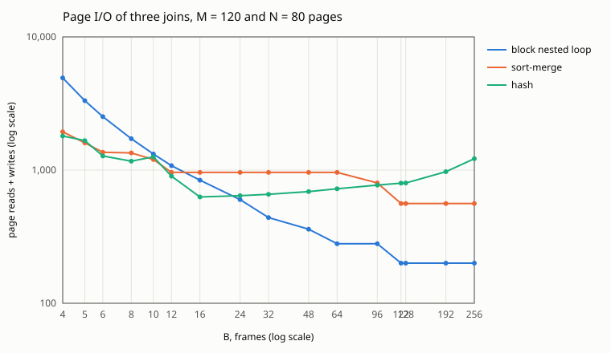
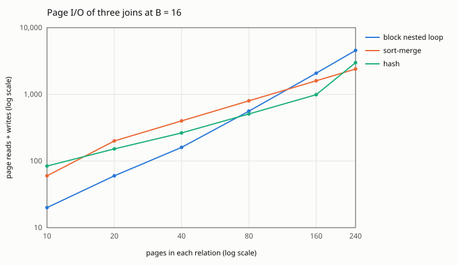

# REPORT_M2.md — Execution engine measurements

Every number here was produced by `python -m bench.m2_measure` and is in `results/m2/*.csv`.
The counts are page reads and page writes made by the disk manager, summed over all operators
of the plan, table scans included. They do not depend on the machine or on timing: running the
script again gives the same files. They were first measured on an earlier storage layer and
measured again after it was replaced by the one Module 1 specifies; every counter was identical.

**Assumptions: the schema, the data and the workload.** No dataset and no plan files were
published with the specification, so both are mine, generated by `bench/m2_measure.py`. Nothing
in them is random.

- **Schema.** One, for every table: `(k INT, v INT, pad VARCHAR(200))`. A record is
  4 + 4 + (2 + 200) = 210 bytes, 214 with its slot, so 19 fit on a page.
- **Data.** `v` is the row number. `pad` is the row number in six digits followed by 194
  letters, always 200 bytes. `k` is a permutation of 0 .. rows − 1: (i × step + 7) mod rows, with
  a prime step that shares no factor with the number of rows.
- **Tables.** `A8`, `A10`, `A20`, `A30`, `A40`, `A60`, `A80`, `A120`, `A160`, `A240`, `A320` and
  `B10`, `B20`, `B40`, `B60`, `B80`, `B160`, `B240`. The number is the page count: `A120` is 120
  pages, 2,280 rows. Because `k` is a permutation in both, joining `A_M` with `B_N` on `k`
  matches every row of the smaller table exactly once. `SkewR` and `SkewS`, 60 pages each, are
  described in section 4.
- **Workload.** Physical plans built by the script, not by the optimizer, so that each algorithm
  is measured whether or not it would be chosen. A join plan is
  `{"op": "hash_join", "condition": "A120.k = B80.k", "left": seqscan A120, "right": seqscan B80}`,
  and the same with `nested_loop_join` and `sort_merge_join`. A sort plan is a `sort` on `k`
  over a `seqscan`. Section 5 runs three deeper plans. Each section says which tables and which
  B it used. The same shapes on a smaller database are in `samples/plans/`.

Wide rows are deliberate: page counts stay meaningful while row counts stay small enough for a
nested loop in Python.

**B** is `--frames`: the size of the buffer pool, which is all the memory a plan has.

## 1. Cost against formula

Formulas, with M the pages of the left input and N of the right:

| Join | Reads | Writes |
|---|---|---|
| block nested loop | M + ⌈M / (B − 2)⌉ · N | 0 |
| sort-merge | M · p(M) + N · p(N) + M + N | M · p(M) + N · p(N) |
| hash | 2 (M + N) | M + N |

p(X) = 1 + ⌈log(⌈X / B⌉) / log(B − 1)⌉ is the number of sort passes, and sort(X) = 2 · X · p(X).

| join | M | N | B | reads: formula | reads: measured | writes: formula | writes: measured | comparisons | peak frames |
|---|---|---|---|---|---|---|---|---|---|
| block nested loop | 20 | 10 | 4 | 120 | 120 | 0 | 0 | 72,200 | 4 |
| sort-merge | 20 | 10 | 4 | 110 | 101 | 80 | 80 | 4902 | 4 |
| hash | 20 | 10 | 4 | 60 | 115 | 30 | 73 | 377 | 4 |
| block nested loop | 20 | 10 | 16 | 40 | 40 | 0 | 0 | 72,200 | 16 |
| sort-merge | 20 | 10 | 16 | 80 | 71 | 50 | 50 | 4819 | 16 |
| hash | 20 | 10 | 16 | 60 | 74 | 30 | 44 | 396 | 16 |
| block nested loop | 20 | 10 | 64 | 30 | 30 | 0 | 0 | 72,200 | 63 |
| sort-merge | 20 | 10 | 64 | 60 | 51 | 30 | 30 | 4715 | 64 |
| hash | 20 | 10 | 64 | 60 | 146 | 30 | 121 | 345 | 64 |
| block nested loop | 20 | 10 | 256 | 30 | 30 | 0 | 0 | 72,200 | 255 |
| sort-merge | 20 | 10 | 256 | 60 | 51 | 30 | 30 | 4715 | 256 |
| hash | 20 | 10 | 256 | 60 | 298 | 30 | 334 | 290 | 256 |
| block nested loop | 60 | 40 | 4 | 1260 | 1260 | 0 | 0 | 866,400 | 4 |
| sort-merge | 60 | 40 | 4 | 500 | 473 | 400 | 392 | 20,512 | 4 |
| hash | 60 | 40 | 4 | 200 | 495 | 100 | 340 | 3821 | 4 |
| block nested loop | 60 | 40 | 16 | 260 | 260 | 0 | 0 | 866,400 | 16 |
| sort-merge | 60 | 40 | 16 | 300 | 281 | 200 | 200 | 18,910 | 16 |
| hash | 60 | 40 | 16 | 200 | 214 | 100 | 114 | 1487 | 16 |
| block nested loop | 60 | 40 | 64 | 100 | 100 | 0 | 0 | 866,400 | 63 |
| sort-merge | 60 | 40 | 64 | 200 | 181 | 100 | 100 | 18,638 | 64 |
| hash | 60 | 40 | 64 | 200 | 249 | 100 | 149 | 1434 | 64 |
| block nested loop | 60 | 40 | 256 | 100 | 100 | 0 | 0 | 866,400 | 255 |
| sort-merge | 60 | 40 | 256 | 200 | 181 | 100 | 100 | 18,638 | 256 |
| hash | 60 | 40 | 256 | 200 | 584 | 100 | 491 | 1374 | 256 |
| block nested loop | 120 | 80 | 4 | 4920 | 4920 | 0 | 0 | 3,465,600 | 4 |
| sort-merge | 120 | 80 | 4 | 1120 | 1049 | 920 | 888 | 48,466 | 4 |
| hash | 120 | 80 | 4 | 400 | 1164 | 200 | 640 | 130,142 | 4 |
| block nested loop | 120 | 80 | 16 | 840 | 840 | 0 | 0 | 3,465,600 | 16 |
| sort-merge | 120 | 80 | 16 | 600 | 561 | 400 | 400 | 44,134 | 16 |
| hash | 120 | 80 | 16 | 400 | 414 | 200 | 214 | 2990 | 16 |
| block nested loop | 120 | 80 | 64 | 280 | 280 | 0 | 0 | 3,465,600 | 64 |
| sort-merge | 120 | 80 | 64 | 600 | 561 | 400 | 400 | 42,977 | 64 |
| hash | 120 | 80 | 64 | 400 | 462 | 200 | 262 | 3086 | 64 |
| block nested loop | 120 | 80 | 256 | 200 | 200 | 0 | 0 | 3,465,600 | 255 |
| sort-merge | 120 | 80 | 256 | 400 | 361 | 200 | 200 | 42,687 | 256 |
| hash | 120 | 80 | 256 | 400 | 708 | 200 | 509 | 2872 | 256 |

**Block nested loop: equal in all twelve rows.** The reason it is exact, not just close: the
join reserves its whole block (B − 2 frames) whether or not the last block fills it, the outer
scan pins one page and the inner scan one. That is all B frames, so no inner page can stay
cached from one pass to the next and every pass really reads N pages. The one place I saw it
differ was during testing, with an inner table of a single page at B = 4: 11 reads against a
formula of 12. The outer scan had just unpinned a page, the pool evicted that older page instead
of the inner one, and the inner page was still there for the next block. That is the buffer pool
doing its job, and it can only happen when N = 1.

**Sort-merge: writes equal, reads below the formula.** Two causes, both visible in the numbers.

1. *The merge stops when one input ends.* B80 has keys 0 to 1,519 and A120 has 0 to 2,279. Once
   the last B row is passed, no later A row can match, and the join stops. The sorted A file is
   120 pages; key 1,520 is the first row of its page 81, so 81 pages are read and 39 are not.
   Measured reads are 39 below the formula at B = 16, 64 and 256 (561 against 600, and 361
   against 400). For 60/40 it is 19 and for 20/10 it is 9: M − N − 1 each time.
2. *Carried runs.* At B = 4 the sort of A120 leaves a run without partners in one merge pass. It
   is carried forward, not read and rewritten. That saves 32 reads and 32 writes: writes are 888
   against 920, and reads are 1,049 against 1,120, which is 32 + 39 below.

The formula charges every page in every pass and a full final read of both inputs. Mine does
strictly less work in both places, never more.

**Hash: three regimes, and the formula describes only the middle one.**

- *B − 1 partitions that fit (120/80 at B = 16: 414 reads, 214 writes against 400 and 200).* The
  14 extra are the last page of each partition, which is only part full. Each input can have up
  to P = B − 1 of them.
- *B too small (120/80 at B = 4: 1,164 and 640 against 400 and 200).* Three partitions of 40
  pages against a table of 3 frames. Every pair overflows and is partitioned again, twice, and
  what is still too large is joined by nested loop. One level of partitioning can only place
  about (B − 1)² pages; section 3 finds that boundary.
- *B too large for the input (20/10 at B = 256: 298 and 334 against 60 and 30).* 255 partitions
  for an input of 20 pages. The 380 rows of A20 land in a couple of hundred different files and
  each file is at least one page, so 20 pages of input become about 200 pages of partitions.
  The cost of the part-filled pages, negligible in the first regime, is now the whole cost. It
  grows with B: the same join costs 118, 267 and 632 at B = 16, 64 and 256.

The third regime is a consequence of always choosing P = B − 1, which the specification
prescribes and I kept. It is the wrong choice when B − 1 is larger than the number of partitions
needed; ⌈M / (B − 1)⌉ with some margin would be enough, and when M ≤ B − 1 no partitioning is
needed at all. I would change that first (see section 6).

## 2. Sort passes

Plan: `sort(seqscan A_N)` on `k`. Formula: runs = ⌈N / B⌉, passes = 1 + ⌈log(runs) / log(B − 1)⌉.

| N pages | B | note | runs: formula | runs: measured | passes: formula | passes: measured | reads: N x passes | reads: measured | writes: N x (passes - 1) | writes: measured |
|---|---|---|---|---|---|---|---|---|---|---|
| 8 | 3 |  | 3 | 3 | 3 | 3 | 24 | 22 | 16 | 14 |
| 8 | 4 |  | 2 | 2 | 2 | 2 | 16 | 16 | 8 | 8 |
| 30 | 4 |  | 8 | 8 | 3 | 3 | 90 | 90 | 60 | 60 |
| 80 | 4 | 20 x B | 20 | 20 | 4 | 4 | 320 | 312 | 240 | 232 |
| 120 | 8 |  | 15 | 15 | 3 | 3 | 360 | 352 | 240 | 232 |
| 160 | 8 | 20 x B | 20 | 20 | 3 | 3 | 480 | 480 | 320 | 320 |
| 120 | 16 |  | 8 | 8 | 2 | 2 | 240 | 240 | 120 | 120 |
| 320 | 16 | 20 x B | 20 | 20 | 3 | 3 | 960 | 960 | 640 | 640 |
| 60 | 64 |  | 1 | 1 | 1 | 1 | 60 | 60 | 0 | 0 |
| 320 | 64 |  | 5 | 5 | 2 | 2 | 640 | 640 | 320 | 320 |

Runs and passes equal the formula in all ten rows, including the three where N = 20 × B.

Page counts equal N × passes and N × (passes − 1) except in three rows, where they are lower by
the size of a carried run: 2 pages for N = 8, B = 3 (the example of the specification: 22 and
14), and 8 pages for N = 80, B = 4 and for N = 120, B = 8. In the 80-page case, pass 1 turns 20
runs into 7; pass 2 groups them 3, 3 and 1, and the single one, 8 pages long, is carried into
the last merge.

Runs are B pages here because the sort is directly above a scan and takes over the scan's frame
when its workspace fills (DESIGN_M2.md section 3). Above anything else the runs are shorter by
the frames the input holds: the same sort above a hash join at B = 8 was given 4 frames for its
runs, because the join held the other 4 while probing.

## 3. Crossover

### 3.1 Relations fixed, B varies

A120 join B80. Page reads plus page writes.

| B | block nested loop | sort-merge | hash | cheapest |
|---|---|---|---|---|
| 4 | 4920 | 1937 | 1804 | hash |
| 5 | 3320 | 1601 | 1664 | sort-merge |
| 6 | 2520 | 1361 | 1276 | hash |
| 8 | 1720 | 1345 | 1166 | hash |
| 10 | 1320 | 1201 | 1258 | sort-merge |
| 12 | 1080 | 961 | 900 | hash |
| 16 | 840 | 961 | 628 | hash |
| 24 | 600 | 961 | 642 | block nested loop |
| 32 | 440 | 961 | 658 | block nested loop |
| 48 | 360 | 961 | 690 | block nested loop |
| 64 | 280 | 961 | 724 | block nested loop |
| 96 | 280 | 801 | 772 | block nested loop |
| 122 | 200 | 561 | 798 | block nested loop |
| 128 | 200 | 561 | 800 | block nested loop |
| 192 | 200 | 561 | 972 | block nested loop |
| 256 | 200 | 561 | 1217 | block nested loop |

**B = 4 to 12: hash and sort-merge trade places, nested loop is far behind.** Sort-merge wins
at 5 and 10, hash at 4, 6, 8 and 12, by 4 to 15 percent. The hash join's curve is
not even monotone (1,166 at B = 8, 1,258 at B = 10). In this range every partition overflows:
120 pages into B − 1 partitions gives 120 / (B − 1) pages each, which fits a table of B − 1
frames only when 120 ≤ (B − 1)², that is from B = 12. Below that the cost depends on how the
second round of partitioning happens to fall, not on the textbook formula.

**B = 16: hash is clearly cheapest, 628 against 840 and 961.** No partition overflows any more
and the cost is 3 (M + N) = 600 plus 28 part-filled pages.

**Between B = 16 and B = 24 the ranking changes: nested loop passes hash and stays ahead.**
The cause is the number of outer blocks. Nested loop costs M + ⌈M / (B − 2)⌉ · N. At B = 24 that
is 120 + 6 · 80 = 600, exactly the hash join's 3 (M + N). Hash cannot improve on 3 (M + N) by
getting more memory; nested loop can, because each extra frame shortens the list of blocks: 4
blocks at B = 32 (440), 3 at 48 (360), 2 at 64 (280), and 1 at B = 122, where the whole outer
input fits in the block and the cost is M + N = 200, the least any join can do. In general nested
loop wins once ⌈M / (B − 2)⌉ < 2 M / N + 3.

**Hash gets worse again after 16** (642, 658, 690, 724, 772, 798, 800, 972, 1,217). That is the
third regime of section 1: more partitions than are useful, each with a part-filled page.

**Sort-merge is a staircase**: 961 while both sorts need two passes, 801 at B = 96 where B80
becomes a single run, 561 from B = 122 where both are.

One caution about the word cheapest. This is page I/O, which is what the cost model counts. At
B = 256 nested loop does 200 page operations and 3,465,600 comparisons; hash does 1,217 and
2,872. Which one finishes first depends on what a comparison costs against a page.

### 3.2 B fixed at 16, relation size varies

A_M join B_M, both M pages.

| M = N pages | block nested loop | sort-merge | hash | cheapest |
|---|---|---|---|---|
| 10 | 20 | 60 | 84 | block nested loop |
| 20 | 60 | 200 | 152 | block nested loop |
| 40 | 160 | 400 | 264 | block nested loop |
| 80 | 560 | 800 | 508 | hash |
| 160 | 2080 | 1600 | 988 | hash |
| 240 | 4560 | 2400 | 2992 | sort-merge |

**Up to 40 pages nested loop is cheapest.** With a block of 14 frames, 40 pages are three blocks:
40 + 3 · 40 = 160. Small inputs are few blocks.

**Between 40 and 80 pages the ranking changes to hash.** Nested loop grows with the square of
the size, M + ⌈M / 14⌉ · M; hash grows linearly, about 6 M. They cross where ⌈M / 14⌉ reaches 5
or 6: at 80 pages nested loop needs 6 blocks (560) and hash costs 508.

**Between 160 and 240 pages it changes again, to sort-merge.** At 240 pages the hash join's
partitions are 240 / 15 = 16 pages and its table has 15 frames. Every partition overflows and is
partitioned a second time: 2,992 instead of about 1,470. The limit of one-level Grace hashing is
M ≤ (B − 1)² = 225 pages. Sort-merge at 240 pages still needs only two passes per input, because
240 pages are 15 runs of 16 and 15 can be merged at once: its limit is M ≤ B (B − 1) = 240. So
the two-pass range of sort-merge reaches a little further, and outside it sort-merge adds one
pass where hash starts over.

## 4. Skew

`SkewR` and `SkewS`, 60 pages and 1,140 rows each. Key 0 is in 456 rows of each (40 percent);
every other key appears once. The uniform comparison is A60 join B60.

| keys | B | partitions | table frames | largest left partition, pages | partitioned again | nested loops | reads | writes | I/O | comparisons | rows out |
|---|---|---|---|---|---|---|---|---|---|---|---|
| uniform | 4 | 3 | 3 | 22 | 12 | 1 | 578 | 402 | 980 | 5468 | 1140 |
| skewed | 4 | 3 | 3 | 36 | 12 | 1 | 886 | 402 | 1288 | 228,784 | 208,620 |
| uniform | 16 | 15 | 15 | 6 | 0 | 0 | 256 | 136 | 392 | 2228 | 1140 |
| skewed | 16 | 15 | 15 | 27 | 2 | 1 | 460 | 268 | 728 | 209,280 | 208,620 |
| uniform | 64 | 63 | 63 | 2 | 0 | 0 | 288 | 168 | 456 | 2144 | 1140 |
| skewed | 64 | 63 | 63 | 25 | 0 | 0 | 296 | 176 | 472 | 209,284 | 208,620 |

Partition sizes at B = 16:

| keys | left partitions | right partitions |
|---|---|---|
| uniform | 4 6 4 4 5 5 4 5 4 5 4 4 5 5 4 | 4 6 4 4 5 5 4 5 4 5 4 4 5 5 4 |
| skewed | 3 3 3 2 3 27 3 3 3 3 3 3 3 3 2 | 3 3 3 2 3 27 3 3 3 3 3 3 3 3 2 |

Uniform keys give 15 partitions of 4 to 6 pages, all of which fit a table of 15 frames. Skewed
keys give 14 partitions of 2 or 3 pages and one of 27: the 456 rows of key 0 are 24 pages on
their own and they must all be in one partition, because equal keys hash alike.

What the overflow handling did with that pair:

| level | left pages | right pages | action |
|---|---|---|---|
| 1 | 27 | 27 | partitioned again |
| 2 | 25 | 25 | partitioned again |
| 3 | 24 | 24 | nested loop |

It was partitioned again, and again. Each round removed a few of the *other* keys that shared
the partition (27 pages, then 25, then 24) and none of key 0. After the third level the pair was
joined by block nested loop: 24 pages of left rows in two blocks of 14 frames, the 24 pages of
right rows read once per block.

**Cost against the uniform case at B = 16: 728 against 392, 1.86 times.** Of the 336 extra,
about 200 is the two rounds of repartitioning, 2 · (27 + 27) + 2 · (25 + 25) reads and writes,
which achieved nothing; the rest is the nested loop reading the right partition twice. The
comparisons tell the other half: 209,280 against 2,228. 456 × 456 = 207,936 of them are the pairs
of key 0, every one of which is a match, so they are also output rows. No algorithm can avoid
those.

**At B = 64 the skew costs nothing**: 472 against 456. The hot partition is 25 pages and the
table has 63 frames. Skew hurts a hash join exactly when the rows of one key do not fit in
memory, not before.

**At B = 4 both cases overflow** (60 pages into 3 partitions), and the skewed one costs 1,288
against 980.

The other two joins on the same skewed data at B = 16:

| join | reads | writes | comparisons | rows out |
|---|---|---|---|---|
| block nested loop | 360 | 0 | 1,299,600 | 208,620 |
| sort-merge | 11,735 | 240 | 228,763 | 208,620 |
| hash | 460 | 268 | 209,280 | 208,620 |

Nested loop does not care about skew at all: 60 + 5 · 60 = 360 reads as for any data, and
1,299,600 comparisons as for any data. Sort-merge is correct but pays for my choice to rewind in
the sorted file instead of holding the run in memory: each of the 456 left rows of key 0
re-reads the 24-page run of the right side, 456 × 24 = 10,944 page reads. It never needs more
than two frames to do it, and it is the most expensive of the three by far.

## 5. The budget

| plan | B | most frames in use at once | rows out | reads | writes | runs | passes |
|---|---|---|---|---|---|---|---|
| sort of A80 (20 x B pages) | 4 | 4 | 1520 | 312 | 232 | 20 | 4 |
| sort over hash join over nested loop | 4 | 4 | 380 | 2473 | 559 | 64 | 5 |
| distinct (hash) of a sort-merge join | 4 | 4 | 1140 | 1386 | 1266 |  |  |

The sort of 80 pages at B = 4 completes: 20 runs of 4 pages, 4 passes, 1,520 rows out in order
(a test checks the order). So do a sort over a hash join over a nested loop join, and a hash
distinct over a sort-merge join, in the same 4 frames.

**The largest number of frames held at once was 4, in all three.** How I know:

1. *It cannot be more.* The buffer pool has exactly B slots and they are the only frames there
   are. A pinned page occupies one, a reserved frame occupies one, and asking for a slot when
   none is free raises an error. These plans ran to the end, so they never asked.
2. *It was measured.* The pool records the highest value of pinned pages plus reserved frames it
   ever saw. `exec trace --verbose` prints it: `frames: budget 4, most in use at once 4`.
3. *Rows in Python lists are behind the same gate.* A sort's run, a join's block and a hash table
   are filled through a `Workspace`, which reserves its frames first and answers no to a row
   that would not fit in them as slotted pages.
4. *It was attacked.* 1,500 random plan trees were each run at B = 4, 5, 8 and 23, compared with
   an independent in-memory engine, and checked for peak frames and for leftover pins,
   reservations and files. A hand-written plan had already caught `union_all` going over the
   budget; the random plans caught it going over in a second way, and a case where it could not
   run in 4 frames at all. All three are fixed, and 160 of those plans are now in the test suite.

What is outside the count is listed in DESIGN_M2.md section 1: the row in flight, Python's
object overhead, and a few constant-size things. None of it grows with the data.

## 6. What I would change

- **Choose the number of hash partitions from the input size**, not always B − 1, and skip
  partitioning when the build input fits in memory. Section 1 shows the cost of not doing so.
- **Give up on repartitioning as soon as it stops helping.** Section 4 shows two wasted rounds
  on a partition that was one key. Comparing a partition's size before and after a split would
  detect that after one round.
- **Sort-merge on heavy duplicates** should keep the right run in memory when it fits and rewind
  in the file only when it does not.

## 7. Sources

- Ramakrishnan and Gehrke, *Database Management Systems*, ch. 13 and 14. The frame split of each
  algorithm comes from here: B − 2 pages of outer for block nested loop, B − 1 runs merged at a
  time, B − 1 partitions. The cost formulas in sections 1 and 2 are theirs.
- Shapiro, *Join Processing in Database Systems with Large Main Memories*, ACM TODS 1986. The
  condition that a hash join needs memory of about the square root of the build input is the
  boundary measured in section 3.2, M ≤ (B − 1)² = 225 pages at B = 16.
- Graefe, *Volcano, an Extensible and Parallel Query Evaluation System*, IEEE TKDE 1994. The
  open / next / close interface, and with it the property the design leans on most: an operator
  does not know what its input is, so a spool or a temporary file can be put in its place.
